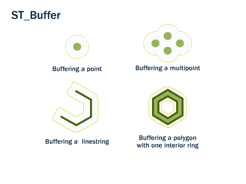

Activity type: **Buffer**.

> Returns a geometric object representing all points whose distance from this geometric object is less than or equal to a given distance.

SQL/MM name: `ST_Buffer`.

## The item

`https://geolabs.github.io/bblocks-generic-profiles/def/activity-type/buffer` is an `acttype:ActivityType` item of this register (`gp:register`), of the Activity Type Register's item class, and an OWL class, sub-class of `geoproc:GeoprocessingActivityType`.

Its activities use or generate geometries: `usedEntityType` `geo:Geometry`; `generatedEntityType` `geo:Geometry`.

The run of an activity of this type is not typed here (decision D8, open).

## Sources

- [OGC 06-103r4 Simple Feature Access - Part 1: Common Architecture, §6.1.23](https://www.ogc.org/standards/sfa/)
- ISO/IEC 13249-3:2016 SQL multimedia and application packages -- Part 3: Spatial, §5.1.5 ST_Buffer

## Illustration

Source: [PostGIS Workshop -- Geometry Returning Functions](https://postgis.net/workshops/postgis-intro/geometry_returning.html), © Paul Ramsey, Mark Leslie, PostGIS contributors, licensed [CC BY-SA 3.0 US](http://creativecommons.org/licenses/by-sa/3.0/us/).

## Profiles of this operation

The Implementation Profile [`generic-profiles.implementation-profile.buffer`](../../implementation-profile/buffer/) points here with `activityType`. It holds the signature and the representations; this item holds the meaning.
