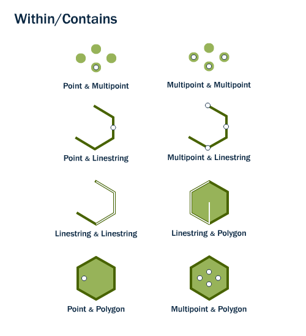

Activity type: **Contains**.

> Returns TRUE if this geometric object spatially contains anotherGeometry (no point of anotherGeometry lies outside this geometric object, and at least one point of the interior of anotherGeometry lies in the interior of this geometric object).

SQL/MM name: `ST_Contains`.

## The item

`https://geolabs.github.io/bblocks-generic-profiles/def/activity-type/contains` is an `acttype:ActivityType` item of this register (`gp:register`), of the Activity Type Register's item class, and an OWL class, sub-class of `geoproc:GeoprocessingActivityType`.

Its activities use or generate spatial data, declared with GeoSPARQL 1.1 classes: `usedEntityType` `geo:Geometry`. The class is chosen per kind of role (see `scripts/activity-types.yaml`); how a data type of `bblocks-data-types` maps to an entity type is still open (decision D8, question 5).

The run of an activity of this type is not typed here (decision D8, open).

## Sources

- [OGC 06-103r4 Simple Feature Access - Part 1: Common Architecture, §6.1.19](https://www.ogc.org/standards/sfa/)
- ISO/IEC 13249-3:2016 SQL multimedia and application packages -- Part 3: Spatial, §5.1.11 ST_Contains

## Illustration

This diagram illustrates `ST_Within`, not `ST_Contains` directly -- PostGIS's own workshop does not give `ST_Contains` a separate figure, since the two predicates are logical inverses of one another (reading the diagram the other way around, with the roles of the two geometries swapped, illustrates `Contains`).

Source: [PostGIS Workshop -- Spatial Relationships](https://postgis.net/workshops/postgis-intro/spatial_relationships.html), © Paul Ramsey, Mark Leslie, PostGIS contributors, licensed [CC BY-SA 3.0 US](http://creativecommons.org/licenses/by-sa/3.0/us/).

## Profiles of this operation

The Implementation Profile [`generic-profiles.implementation-profile.contains`](../../implementation-profile/contains/) points here with `activityType`. It holds the signature and the representations; this item holds the meaning.
