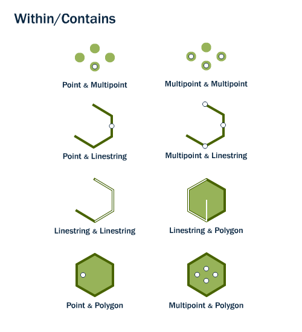

Activity type: **Within**.

> Returns TRUE if this geometric object is spatially within anotherGeometry. The converse of Contains.

SQL/MM name: `ST_Within`.

## The item

`https://geolabs.github.io/bblocks-generic-profiles/def/activity-type/within` is an `acttype:ActivityType` item of this register (`gp:register`), of the Activity Type Register's item class, and an OWL class, sub-class of `geoproc:GeoprocessingActivityType`.

Its activities use or generate geometries: `usedEntityType` `geo:Geometry`.

The run of an activity of this type is not typed here (decision D8, open).

## Sources

- [OGC 06-103r4 Simple Feature Access - Part 1: Common Architecture, §6.1.18](https://www.ogc.org/standards/sfa/)
- ISO/IEC 13249-3:2016 SQL multimedia and application packages -- Part 3: Spatial, §5.1.51 ST_Within

## Illustration

Source: [PostGIS Workshop -- Spatial Relationships](https://postgis.net/workshops/postgis-intro/spatial_relationships.html), © Paul Ramsey, Mark Leslie, PostGIS contributors, licensed [CC BY-SA 3.0 US](http://creativecommons.org/licenses/by-sa/3.0/us/).

## Profiles of this operation

The Implementation Profile [`generic-profiles.implementation-profile.within`](../../implementation-profile/within/) points here with `activityType`. It holds the signature and the representations; this item holds the meaning.
