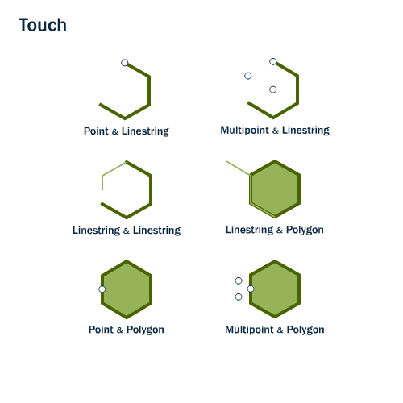

Implementation Profile: **Touches**.

> Implementation Profile of the operation Touches, whose meaning is its activity type (activityType): the signature of the Generic Profile Binary spatial predicate, bound to data exchange formats.

## Activity type

The meaning of the operation -- its definition, the standards that define it and its illustration --
is the activity type [`generic-profiles.activity-type.touches`](../../activity-type/touches/), to which this
profile points with `activityType` (decisions D3 and D4).

## Signature and representations

The signature of the Generic Profile [Binary spatial predicate](../../generic-profile/binary-spatial-predicate/), with each data-carrying
input and output bound to a representation of the
[`bblocks-data-formats`](https://github.com/GeoLabs/bblocks-data-formats) register (Table 21 Data
format, D; decision D6):

| Role | Data type | Representation |
|---|---|---|
| input `geometry1` | `geometry` | [`geometry-gml`](https://w3id.org/geolabs-ospd/data-formats/representation/geometry-gml) (Geometry as GML) |
| input `geometry2` | `geometry` | [`geometry-gml`](https://w3id.org/geolabs-ospd/data-formats/representation/geometry-gml) (Geometry as GML) |
| output `result` | `boolean` | -- |

The representations are a minimal default: a deployment may support more formats (OGC 14-065 WPS
2.0.2 §7.5.4 Table 21, footnote d).

## Source

Two standards define this operation at different levels -- the abstract semantics, and the
concrete SQL binding an Implementation Profile is specifically meant to add (OGC 14-065 WPS 2.0.2
§7.5.3, "down to the supported data exchange formats"):

- [OGC 06-103r4 Simple Feature Access - Part 1: Common Architecture](https://www.ogc.org/standards/sfa/), §6.1.20 -- the
  operation's abstract definition (this is what [its Concept](../../concept/vector-geometry-processing/)
  and [Generic Profile](../../generic-profile/binary-spatial-predicate/) are grounded in too).
- ISO/IEC 13249-3:2016 *SQL multimedia and application packages -- Part 3: Spatial*, §5.1.49 ST_Touches
  -- the same operation bound to SQL: the `ST_Geometry` type and the `ST_Touches` function name,
  of which this Implementation Profile's `prefLabel` (`Touches`) is the SFA name without the `ST_`
  prefix SQL/MM adds. SQL/MM is why this tier exists at all: it is, precisely, an implementation
  profile of Simple Feature Access for SQL -- the same abstract operation, bound to one concrete
  language and type system, still not any one vendor's specific deployment of it.

## Illustration

Source: [PostGIS Workshop -- Spatial Relationships](https://postgis.net/workshops/postgis-intro/spatial_relationships.html), © Paul Ramsey, Mark Leslie, PostGIS contributors, licensed [CC BY-SA 3.0 US](http://creativecommons.org/licenses/by-sa/3.0/us/).

## Data formats

`geometry1`, `geometry2`: GML -- the register's minimal default (Table 21, D: Declare), grounded in the real ZOO-Project Geonovum testbed, whose SQL/MM processes expose geometries as `text/xml` (GML) only, never WKT or GeoJSON (checked across `Intersects`, `Buffer`, `Intersection`). `result` (Boolean) carries no data format.

Per [OGC 14-065 WPS 2.0.2 §7.5.4 Table 21](https://docs.ogc.org/is/14-065/14-065.html#32), a specific deployment may *Extend* (E, footnote d) this minimal default with additional formats it happens to support -- this tier intentionally does not pre-empt that.

## Relations

- `refinesGenericProfile`: [`generic-profiles.generic-profile.binary-spatial-predicate`](../../generic-profile/binary-spatial-predicate/)
- `activityType`: [`generic-profiles.activity-type.touches`](../../activity-type/touches/)

## Register position

Third tier of the four-tier model (OGC 14-065 WPS 2.0.2 §7.5): Concept -> Generic Profile ->
**Implementation Profile** -> Implementation (instance level). The fourth tier is not part of
this register: see [`ospd.process-profiles.sqlmm.touches`](https://github.com/GeoLabs/bblocks-process-profiles/tree/master/_sources/sqlmm/touches)
in `bblocks-process-profiles` -- a real process of the ZOO-Project Geonovum testbed
(<https://host1.tb.geonovum.geolabs.fr/ogc-api/processes/Touches>), which matches this tier's own minimal default (GML), specialised to one concrete version and root element, GML 3.1.0 Polygon.

That process names this profile with `implementsProfile`. Tools, hosts and testbeds are
recorded there; this item carries none as keyword or source (decision D4). The sections
above keep the tools and testbed that its defaults were grounded in.

## Changes

A proposal, amended in place on 2026-11-09 (`gp:amendmentAction`):

- `meaning-2026-11-09`, substantive
- `operation-sources-2026-11-09`, clarifying
- `representation-2026-11-09`, substantive
- `tools-2026-11-09`, clarifying
- `sections-restored-2026-11-09`, clarifying
